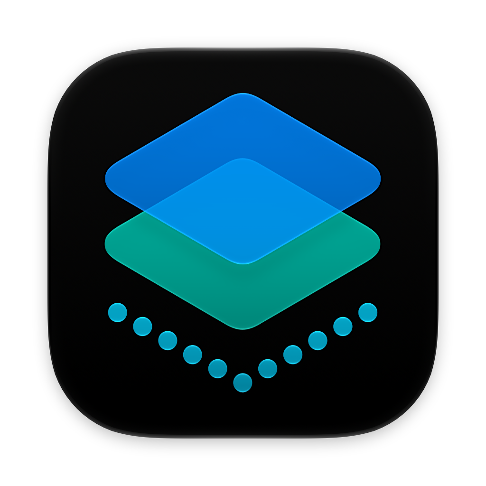

<p align="center">
  
</p>

<h1 align="center">IconMator</h1>

<p align="center">
  <strong>.icon → .icns</strong><br>
  Native macOS Icon Converter
</p>

<p align="center">
  
  
  <a href="LICENSE"></a>
</p>

IconMator converts Apple Icon Composer `.icon` documents into static `.icns` files using Apple's local rendering tools. Import an icon, preview it, and export without creating an Xcode project or copying images from Finder.

## Features

- Drag and drop or choose `.icon` files, with automatic previews.
- Choose **macOS 26** or **macOS 27** rendering independently of **Default**, **Dark**, or **Mono** appearance for the preview, PNG, and ICNS.
- Convert individual icons or batches with collision-safe filenames.
- Export ten standard ICNS representations through 1024 × 1024, preserving transparency.
- Optionally save the same 1024 × 1024 PNG used by the ICNS.
- Cancel work, inspect diagnostics, and reveal verified exports in Finder.

Conversion runs locally, without network access or third-party package dependencies. Source documents are never modified. The output is a static appearance snapshot, not a replacement for Icon Composer's editable layers or runtime materials.

## Requirements and Status

Conversion requires **a full Xcode installation with an active macOS SDK in the 27.x family (including Beta and RC)**, on macOS 26 or later. Exact Xcode and macOS build numbers are not restricted. macOS 26 rendering, Dark, and Mono require the selected Xcode’s bundled Icon Composer renderer. macOS 27 + Default keeps the measured compiled-asset path when the host is a known macOS 27 system; every other combination uses an explicit Composer `--design-generation` request. Selecting macOS 26 rendering does not switch SDKs or change the selected Xcode.

Rendering was measured on macOS 27.0.1 (26A434) with Xcode 27.1 (27A9275). Allowing the SDK 27 family is a compatibility policy, not a claim that every combination has been tested. Tool failures and invalid output are still rejected.

The accepted macOS 27 + Default output remains byte-identical to the prior implementation on the recorded host. Rendering is numerically close to the supplied Finder reference, but is not pixel-identical. Generation selection changes Apple’s material/colour rendering; the final static canvas is still presented by the current host, so it does not emulate every part of Finder on another macOS installation. See the [validation report](Docs/Research/VALIDATION_REPORT.md) and [generation research](Docs/Research/GENERATION_RESEARCH.md). The app targets macOS 26+, but that deployment target does not imply validated conversion on every supported OS.

## Usage

1. Import `.icon` documents using the shared drop/preview area.
2. Select an export folder, choose **macOS 26** or **macOS 27** rendering and the **Default**, **Dark**, or **Mono** appearance, and optionally enable **Include PNG**.
3. Choose **Convert to ICNS** or **Convert All**.

Existing exports require confirmation before replacement. Changing rendering or appearance clears the previous preview/export status so a result is never presented as another combination. Closing the last main window quits the app.

## Build From Source

Open `IconMator.xcodeproj`, select the **IconMator** scheme, and build. Both Debug and Release use a local non-sandboxed configuration with Hardened Runtime; they have separate bundle identifiers so they can coexist.

For the command-line converter:

```sh
swift build --disable-sandbox --scratch-path .build/native
.build/native/debug/iconmator convert "AppIcon.icon" "AppIcon.icns" \
  --generation 26 --appearance dark --png
```

See [Development](Docs/DEVELOPMENT.md) for app builds, tool discovery, signing, CLI commands, and automated tests. The repository does not provide notarized release packaging.

## Documentation

Start at [Docs/README.md](Docs/README.md).

- [Development and CLI](Docs/DEVELOPMENT.md)
- [Architecture](Docs/ARCHITECTURE.md)
- [Rendering research](Docs/Research/RENDERING_RESEARCH.md)
- [Appearance research](Docs/Research/APPEARANCE_RESEARCH.md)
- [Generation research](Docs/Research/GENERATION_RESEARCH.md)
- [Validation report](Docs/Research/VALIDATION_REPORT.md)
- [Third-party notices](Docs/THIRD_PARTY_NOTICES.md)

## License

Original code and documentation are licensed under [MIT](LICENSE), copyright 2026 Chris Lloyd. Application artwork, system components and converted images retain their respective rights; see [Third-party notices](Docs/THIRD_PARTY_NOTICES.md).
